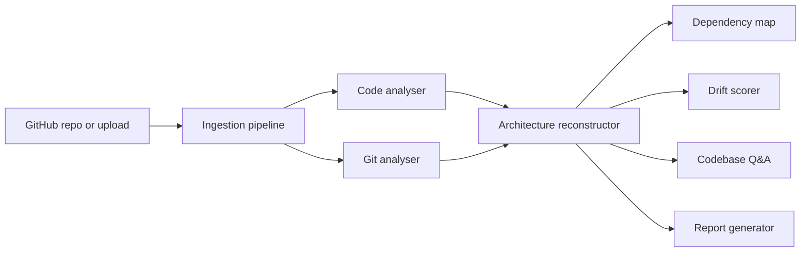

<div align="center">

# Architecture Archaeologist

**Ingest a repository, then ask how it actually works.**

[](https://adineo-cmd2.github.io/architecture-archaeologist/)
     

[](https://github.com/adineo-cmd2/architecture-archaeologist/stargazers) [](https://github.com/adineo-cmd2/architecture-archaeologist/commits)

[Live site](https://adineo-cmd2.github.io/architecture-archaeologist/) · [Quick start](#quick-start) · [How it works](#how-it-works) · [Features](#features)

</div>

---

Point it at a GitHub repository or upload a tree. The engine maps the
architecture, answers questions about structure and dependencies, scores drift,
and writes an archaeology report describing how the system really fits together.

The room is called **Architecture Archaeologist** inside Atrium.

## Features

| | Feature | What it does |
| --- | --- | --- |
| 📥 | **Repo ingestion** | Clone or upload a codebase; source files and history are indexed. |
| 🗺️ | **Dependency maps** | Reconstructs modules and edges from code and git history. |
| 💬 | **Codebase Q&A** | Answers structural questions with the files that justify the answer. |
| 📊 | **Drift scoring** | Flags where the documented architecture and the code have parted ways. |

## How it works

Ingestion produces a queryable model of the repository:

1. **Ingest** — `POST /api/codebase/github` or `/upload` stores source files.
2. **Analyse** — `code_analyser` and `git_analyser` extract structure, imports and
   change history.
3. **Reconstruct** — `architecture_reconstructor` builds the component map;
   `drift_scorer` compares it with what the repository claims.
4. **Ask and report** — codebase Q&A and the report generator read the same model.



## Quick start

Backend needs Python 3.11+ and a virtualenv. Frontend needs Node 18+.

**Backend**

```bash
cd backend
python3 -m venv .venv && source .venv/bin/activate
pip install -r requirements.txt
cp .env.example .env          # add a provider key for live model calls
python3 -m uvicorn app.main:app --reload --port 8007
```

**Frontend**

```bash
cd frontend
npm install
npm run dev                   # http://localhost:4327
```

**Tests**

```bash
python3 -m pytest backend/tests/ -v
```

## Project structure

```text
backend/
  app/
    main.py        FastAPI app and router mounting
    api/           request dependencies
    models/        SQLAlchemy tables
    schemas/       Pydantic request/response models
    services/      the analysis pipeline
  tests/           pytest suite
frontend/
  src/pages/       Astro routes
  src/lib/         API client and shared helpers
```

## Configuration

| Variable | Default | Purpose |
| --- | --- | --- |
| `DATABASE_URL` | `sqlite:///./archaeologist.db` | Per-app SQLite database |
| `JWT_SECRET` | `dev-only-change-me` | Session token signing |
| `ANTHROPIC_API_KEY` | (empty) | Anthropic provider for live analysis |
| `OPENAI_API_KEY` | (empty) | OpenAI provider for live analysis |
| `FRONTEND_ORIGIN` | `http://localhost:4327` | Allowed CORS origin |

## Deployment

The frontend is a static build and deploys to GitHub Pages on every push
to `main` through `.github/workflows/deploy.yml`:

**https://adineo-cmd2.github.io/architecture-archaeologist/**

The backend is not part of that deployment. Run it yourself, then point the
frontend's API base at it.

## Part of the suite

This app is one of ten independent rooms in
**[Atrium](https://github.com/adineo-cmd2/atrium)**. Each room has its own
backend, SQLite database, search index and frontend; the portal only links them.

- [Code Optimizer](https://github.com/adineo-cmd2/code-optimizer) — proposes measured optimizations.
- [Unknown Research Engine](https://github.com/adineo-cmd2/unknown-research-engine) — maps a field's open questions.
- [Premortem Engine](https://github.com/adineo-cmd2/premortem-engine) — finds how a plan fails.

## Contributing

Issues and pull requests are welcome. For anything larger than a typo or a
small fix, open an issue first so the approach can be agreed before the work.

- Bugs and ideas: [issues](https://github.com/adineo-cmd2/architecture-archaeologist/issues)
